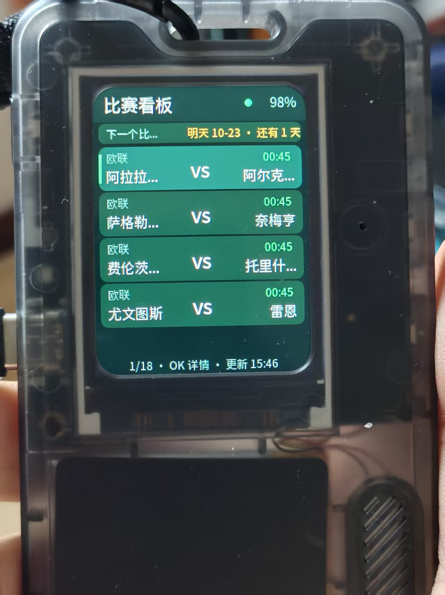
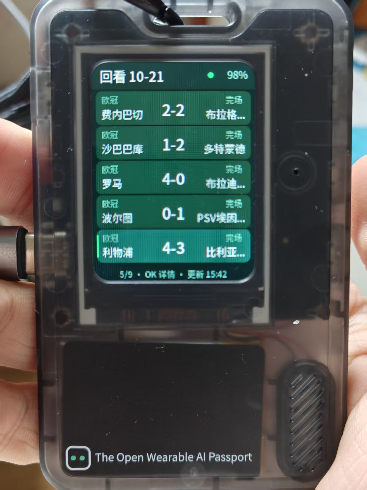
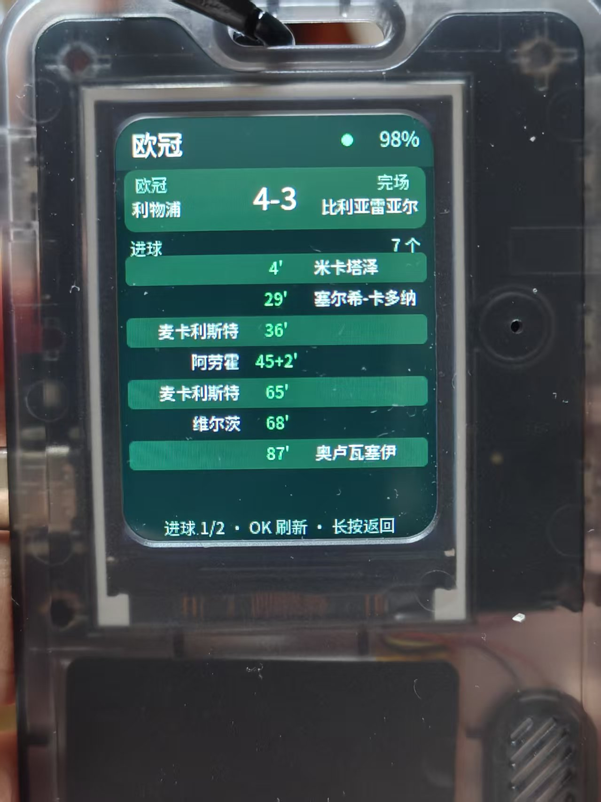
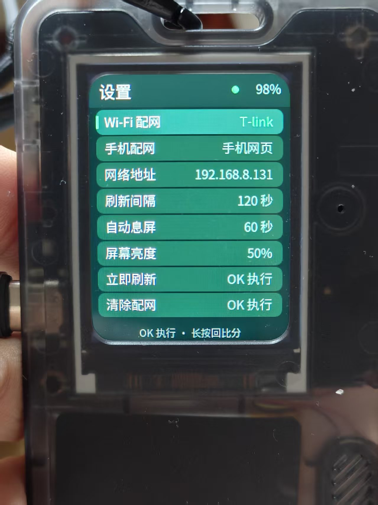

<p align="right">
  <a href="README.zh_CN.md">简体中文</strong> · <strong>English</a>
</p>

# Football Live Board (FoloToy-AI-Passport · feature/football-live-board)

A live-score board built on top of [FoloToy AI Passport](https://gitee.com/FoloToy/ai-passport)
(ESP32-C3, LVGL Chinese UI, three ADC keys). The device pulls football matches over
Wi-Fi from the public [Dongqiudi](https://www.dongqiudi.com/match) feed and renders
them with a purpose-built Chinese screen. Provisioning happens without a computer,
either through an on-screen keyboard or a phone web page. This repository is a fork;
the board is the one application owned by the `feature/football-live-board` branch.

The full design notes, measurements and debugging history live in the application
archive [`docs/reference/kaka/football-live-board.md`](docs/reference/kaka/football-live-board.md).
The upstream project overview is [`docs/README.md`](docs/README.md).

## What it does

- **Today only**: live matches first, then today's fixtures, then today's finished
  matches, up to 40 rows. Early-morning kick-offs (00:45 / 03:00 Champions League and
  Europa League) belong to today, so they stay visible during the day.
- **Page both ways**: press Up again on the first row to go back one day (header turns
  into `Replay 10-21`), press Down on the last row to go forward one day (`Tomorrow
  10-23`), up to seven days ahead. That is how tomorrow's early kick-offs stay
  reachable during the day. Those days barely change, so each is fetched once and
  never polled.
- **Nine competitions**: Premier League, La Liga, Serie A, Bundesliga, Ligue 1,
  Chinese Super League, China League One, plus the Champions League and the Europa
  League. Everything else is dropped.
- **GOAL splash on cold boot**: an 8-frame pixel-art ball curls into the net and
  `GOAL!` bursts, about 2.2 s. It is skipped on key wake, and because the frames are
  L8 grayscale in flash it costs 600 KB of flash and no RAM.
- **Says "no matches" out loud**: when the day is empty it jumps to the nearest match
  day and pins an amber banner (`Next match day 10-24 · in 3 days`); if nothing is
  scheduled within seven days it shows "No matches soon" instead of a blank page.
- **Match detail**: VIEW opens one match, paging toggles between the goal timeline
  and formation + eight statistics. Home side on the left, away on the right, minute
  in the middle, penalties marked, own goals marked. Not-yet-started matches read
  "Match not started" rather than pretending to be an error.
- **Two provisioning paths**: scan and type on the panel, or let the device host an AP
  and fill a phone web page. Working networks are stored in NVS, so the password is
  typed once.
- **Memory first**: no PSRAM. The list response is 1.6 MB and the largest detail
  response is 37.9 KB, so both are streamed through a 1 KB window and leave about
  25 KB of free heap at runtime.

## Photos

The device is an ESP32-C3 replica board with an ST7789P3 240x320 portrait panel and
three keys on one ADC, inside FoloToy's transparent case. The four photos were taken
on 2026-10-22: tomorrow's eighteen Europa League ties reached by paging forward,
the previous day's nine Champions League results reached by paging back, the goal
timeline of Liverpool 4-3 Villarreal (player names now render instead of `?`), and
the settings screen with auto screen-off and brightness.

| Scores · tomorrow | Replay · previous day |
| :---: | :---: |
|  |  |

| Detail · goal timeline | Settings |
| :---: | :---: |
|  |  |

## Hardware and prerequisites

- ESP32-C3 replica board, 8 MB flash, ST7789P3 240×320 portrait panel, three keys on
  one ADC.
- ESP-IDF **5.5.3** (LVGL 9.5 comes from the component manager).
- Flashing: `idf.py -p PORT flash` with the board in download state.

## Screens and keys

| Page | Content |
| --- | --- |
| Scores | live / today not started / today finished; "league + state" above, "home score away" below |
| Replay | yesterday's finished matches, header shows `Replay MM-DD` |
| Future | day N's fixtures, header shows `Tomorrow MM-DD` / `MM-DD` |
| Detail 1 | score strip + goal timeline |
| Detail 2 | formation + eight statistics |
| Settings | Wi-Fi setup, phone setup, network address, refresh interval (60/120/300 s), screen timeout (never/30/60/120 s), brightness (25/50/75/100%), refresh now, forget |
| AP / password / phone | scanned SSIDs, on-screen keyboard, phone provisioning guide |

| Key | Scores | Detail | Settings |
| --- | --- | --- | --- |
| Up / down tap | move selection; tap again at either end to page the date | flip sub-page | move selection |
| OK tap | open detail | re-fetch this match | run current row |
| OK long press | enter settings | back to scores | back to scores |

Brightness follows the 25/50/75/100% choice in settings; after the configured idle
timeout the backlight turns off, and any key turns it back on showing the latest
scores (the board keeps refreshing while the screen is dark).

## Build and flash

```bash
idf.py set-target esp32c3
idf.py build
idf.py -p COM3 flash
```

Merged image written from `0x0` (bootloader + partition table + app):

```bash
idf -B build merge-bin -o FoloToy-AI-Passport-full.bin
```

`tools/verify_firmware.py` and `tools/archive_firmware.py` check and archive each
build so a firmware can be rolled back by hash.

## Serial console

USB Serial/JTAG, 115200, after boot:

```text
wifi set <ssid> <password>   store Wi-Fi and connect now
wifi status / wifi clear     inspect / drop stored Wi-Fi
board interval <60|120|300>  auto-refresh interval
board bright <25|50|75|100>  screen brightness
board screenoff <0|30|60|120>  auto screen-off, 0 = always on
board refresh                refresh now
board day [n]                inspect / switch the date view (0=today, -1=yesterday, 1..7)
board detail <match_id>      fetch one match's detail (debugging)
```

## Verified / not verified

- **Measured on hardware**: Wi-Fi association and persistence across reboot, AP
  scanning, SNTP time sync, TLS handshake, list refresh over the full 401-match
  response, match-detail parsing at every observed payload size (187 bytes
  not-yet-started through 37.9 KB finished), Chinese glyph rendering, key navigation
  and both provisioning flows.
- **Not measured**: long-run stability, power draw, battery readings.

## Upstream and licensing

- Upstream repository and baseline:
  [`gitee.com/FoloToy/ai-passport`](https://gitee.com/FoloToy/ai-passport); the fork
  workflow is described in [`docs/fork-guide.md`](docs/fork-guide.md).
- Font subsets are generated by `tools/gen_fonts.py` from Source Han Sans
  (SIL OFL 1.1, not committed); see
  [`assets/README.md`](assets/README.md).
- The code follows the upstream **MIT** license; see [`LICENSE`](LICENSE).
